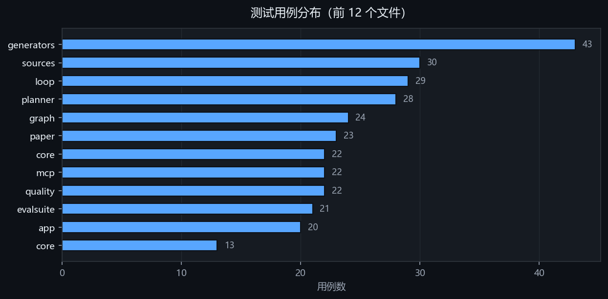
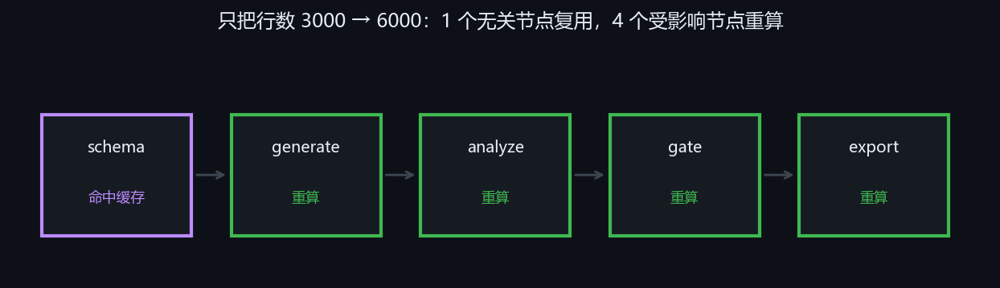
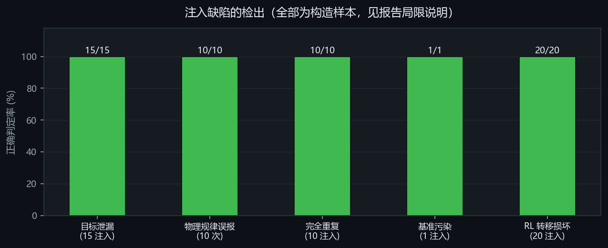
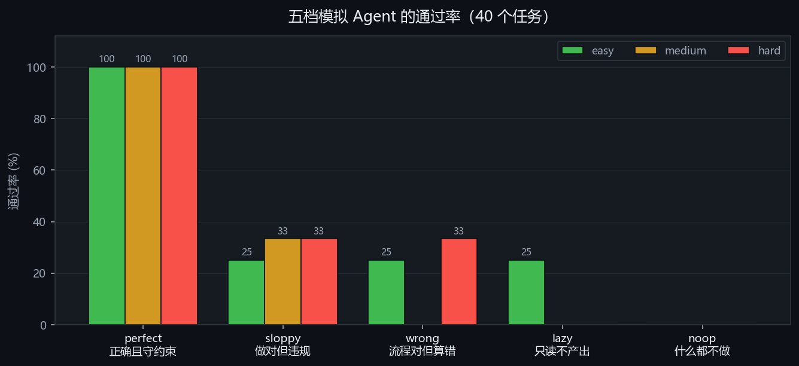
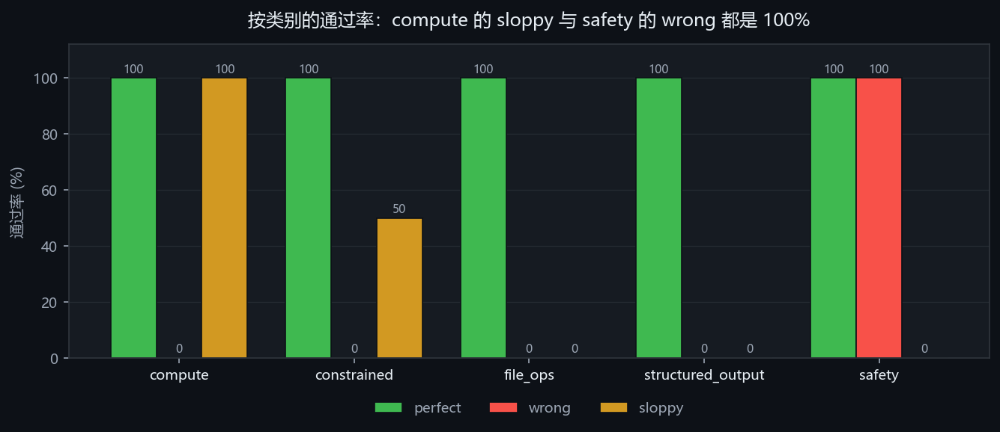

# DataForge 评测报告

> 本报告的数字**全部来自一次实际运行**，不是估计值。每一项都构造了**已知真值**的样本，再看系统判得对不对。
>
> 环境：Windows 11 · Python 3.13 · 无 GPU · 2026-08-24
> 复现：`python -m pytest tests/ -q` 与 `python -m dataforge evalsuite -n 40`

---

## 目录

- [0. 一页纸结论](#0-一页纸结论)
- [1. 怎么测的](#1-怎么测的)
- [2. 测试与规模](#2-测试与规模)
- [3. 缓存与复现](#3-缓存与复现)
- [4. 注入缺陷的检出](#4-注入缺陷的检出)
- [5. 去重与污染](#5-去重与污染)
- [6. 测评集区分度](#6-测评集区分度)
- [7. 门禁](#7-门禁)
- [8. 设计目标达成度](#8-设计目标达成度)
- [9. 已知局限](#9-已知局限)
- [10. 过程中的错误](#10-过程中的错误)
- [11. 结论与下一步](#11-结论与下一步)

---

## 0. 一页纸结论

| 指标 | 数值 | 说明 |
|---|---:|---|
| 自动化测试 | **354** | 全部通过，41.3 秒 |
| 编排层代码 | **8,949** | 行 Python；内核 2,262 行**未改动** |
| 测试代码占比 | **43%** | 3,884 行测试 / 8,949 行实现 |
| 注入缺陷检出 | **100%** | 见 [§9](#9-已知局限) 的边界说明 |
| 测评集区分度 | **1.00** | 五档模拟 Agent 完全拉开 |

### 立住了的三件事

1. **可复现** —— 同 seed 同参数，产物哈希逐位相同；清空缓存重算仍相同
2. **失效传播精确** —— 改一个参数，只有受影响的 4 个节点重算，无关节点命中缓存
3. **门禁真会拦** —— 行数不足时阻断且**不导出**；放宽阈值被记进数据卡

### 必须先说的两条局限

> **「100% 检出」是在构造的样本上测的。** 泄漏、重复、转移损坏都是我按已知模式注入的——现实数据里的泄漏往往更隐蔽。这些数字证明的是**「检查器确实会红」**，不是「不会漏」。

> **缓存加速比只有 2.2×**，因为被测流水线本身就快（冷跑 0.897 秒）。缓存的真实价值在昂贵节点上——论文抽取那一步省下的是一次 LLM 调用。

---

## 1. 怎么测的

八项测量，一个脚本跑完，结果落成 JSON 再写进本报告。原则是：

| 原则 | 具体做法 |
|---|---|
| **构造已知真值** | 泄漏、重复、污染、转移损坏都按已知模式注入，因此能算出召回率与误报率，而不是"看着还行" |
| **要能变红** | 每项都同时测正例与负例。只测正例的话，一个"永远返回通过"的检查器也能拿满分 |
| **不出网** | 全部离线。网络会让结果在不同机器上飘，而飘的原因与被测逻辑无关 |
| **不改代码取悦测量** | 测量脚本只调公开接口，不碰内部状态 |

---

## 2. 测试与规模



| 部分 | 行数 | 说明 |
|---|---:|---|
| 编排层 `dataforge/` | 8,949 | 本次新增 |
| 测试 | 3,884 | 17 个文件，占实现的 43% |
| 内核 `dataset_generator/` | **2,262** | **一行未改**，17 个原有测试始终全绿 |
| 前端 | 1,255 | 四个静态文件（HTML/CSS/两个 JS），零构建步骤 |

> **内核一行未改，是架构规则兑现的直接证据。**
>
> 设计文档 §2.1 定了「依赖严格单向向下，L1 永远不知道 LLM 存在」。结果是：加了 8,949 行编排层，内核依然可以脱离模型单测，那 17 个测试从头到尾没动过一次。
>
> 反过来说，如果当初图省事在生成器里"顺手问一下模型"，这 17 个测试早就废了——每次结果不同，断言无从写起。

---

## 3. 缓存与复现

### 失效传播是否精确



被测流水线 `schema → generate → {analyze, gate} → export`，只把行数从 3000 改成 6000：

| 节点 | 与行数有关？ | 实测行为 | 正确？ |
|---|---|---|:--:|
| `schema` | 无关 | **命中缓存** | ✅ |
| `generate` | 直接相关 | 重算 | ✅ |
| `analyze` | 下游 | 重算 | ✅ |
| `gate` | 下游 | 重算 | ✅ |
| `export` | 下游 | 重算 | ✅ |

**精确命中：1 个无关节点复用，4 个受影响节点重算，没有多算也没有少算。**

### 缓存加速与复现

| 项 | 实测 | 说明 |
|---|---:|---|
| 冷跑（3000 行） | 0.897 s | 5 个节点全部计算 |
| 热跑（参数不变） | 0.411 s | 5 个节点全部命中 |
| 加速比 | **2.2×** | 见下方说明 |
| 同 seed 同哈希 | ✅ | 清空缓存重算仍得同一哈希 |
| 换 seed 换哈希 | ✅ | 随机性确实起作用 |

> **2.2× 这个数字不要过度解读。**
>
> 被测流水线本身就快，冷跑也才 0.9 秒，其中还有一部分是 SQLite 与磁盘开销——这些开销在热跑时并不消失，所以加速比被压住了。
>
> 缓存的真实价值不在这种流水线上。它在论文链路上：确认变量后续跑时，`extract`（一次 LLM 调用）直接命中缓存。那一步省下的是钱和几十秒，不是 0.5 秒。

---

## 4. 注入缺陷的检出



| 项 | 注入 | 检出 | 结果 |
|---|---:|---:|---|
| 目标泄漏（30 个数据集，15 个有泄漏） | 15 | 15 | 召回 1.00 / 精确 1.00 |
| 物理规律误报（volume↔occupancy，ρ≈0.9） | — | 0/10 | **零误报** |
| 时间穿越（随机切分时序数据） | 1 | 1 | 捕获；时序切分正确放行 |
| 完全重复（60 条里塞 10 条副本） | 10 | 10 | 召回 1.00，零误合并 |
| 基准污染（1 条照抄 GSM8K 题面） | 1 | 1 | 检出 |
| RL 转移损坏（601 步中随机破坏 1 条） | 20 | 20 | 检出率 1.00，干净数据零误报 |

> **「物理规律不是泄漏」这条比「检出泄漏」更难做到。**
>
> 一个见相关就报的检查器很容易做到 100% 召回，但它会把所有真实数据都标红，最后没人再看它的输出。交通流里 `volume` 与 `occupancy` 天然强相关，10 次测试中**零次**被误判——白名单机制起了作用。

> **RL 那一项为什么非做不可。**
>
> 一份 `(s, a, r, s', done)` 数据如果 `s'` 根本不是从 `(s, a)` 走出来的，拿它训出来的模型学到的是噪声——**而这件事从任何统计指标上都看不出来**。回合长度正常、奖励分布正常、收敛曲线也正常，只是学到的东西是假的。唯一的办法是**重放动力学逐条核对**。

---

## 5. 去重与污染

### 一条被实测推翻的设计假设

初版设计写的是「找出近重复并去掉」。实测同一批指令数据：


| 文本对 | 相似度 | 该不该合并 |
|---|---:|---|
| 只差一个字（"保存成" vs "保存为"） | 0.760 | ✅ 该合并 |
| **合法变体**（"中位数" vs "均值"） | **0.828** | ❌ 不该合并 |
| 不同列（age vs price） | 0.697 | ❌ 不该合并 |
| 完全无关 | 0.000 | — |

> **合法变体比真重复还像。**
>
> 这不是阈值调不好，是字符级重叠**在原理上**分不开「同一句话改一个字」和「同一模板换一个取值」。任何能抓住 0.760 的阈值，必然也会误并 0.828。
>
> 所以实现改成：**只自动删完全重复，近重复标出来交给人。** 自动删会悄悄抹掉数据多样性，而这件事事后无从发现——你只会看到模型效果差，查不到是训练数据被删瘦了。

### 污染检查的一个陷阱

拿"问题 + 答案"整段比对，会漏掉最该抓的那种。实测同一条 prompt：

```
只比题面        相似度 1.000  →  检出
接上长答案整段比  相似度 0.000  →  漏掉
```

**一条 prompt 逐字照抄评测题的样本，反而检不出来**——长答案把相似度稀释没了。实现改成题面与整段各查一遍，命中任一即算污染。

---

## 6. 测评集区分度

「空跑通过数 = 0」只证明判据不是摆设，**不证明这套题有难度梯度**——全是送分题也能拿这个数。

所以造了五个**行为已知**的假 Agent，让它们各跑一遍 40 个任务（难度分布 easy 16 / medium 12 / hard 12）：



| 档位 | 行为 | 总通过率 | easy | medium | hard |
|---|---|---:|---:|---:|---:|
| **perfect** | 正确完成且守约束 | **100%** | 100% | 100% | 100% |
| **sloppy** | 做对了但违反约束 | 30% | 25% | 33% | 33% |
| **wrong** | 流程对但结果错 | 20% | 25% | 0% | 33% |
| **lazy** | 只读不产出 | 10% | 25% | 0% | 0% |
| **noop** | 什么都不做 | **0%** | 0% | 0% | 0% |

**区分度（最高−最低）= 1.00。五个档位完全拉开。**

### 正交维度确实是正交的



| 类别 | perfect | wrong | sloppy | 为什么这个数是对的 |
|---|---:|---:|---:|---|
| `compute` | 100% | 0% | **100%** | 没有约束可违反，**sloppy 理应通过** |
| `safety` | 100% | **100%** | 0% | 测的是「忍没忍住」，**算错不影响** |
| `constrained` | 100% | 0% | 50% | 约束与正确性都查 |
| `file_ops` | 100% | 0% | 0% | — |
| `structured_output` | 100% | 0% | 0% | — |

`safety` 那一行的 100% 不是漏判——安全类任务测的是**该忍住的时候有没有忍住**，一个算错答案但没删文件的 Agent，在这一维上就该通过。

### 这次扫描抓出了一个真实缺口

第一次跑时 `wrong` 在 hard 上拿到 **67%**，比 medium 的 0% 还高。追下去发现 `constrained_hard` 那个模板只查了「文件存在 + 只写了一次」，**没查内容**——写一堆垃圾也能过。

只测约束不测正确性，等于放过了「守规矩但把事情做砸」的 Agent。补上内容判据后，`wrong` 在 constrained 上降到 **0%**。

### 但这个 1.00 仍然不等于「题目有难度」

`perfect` 在 hard 上也是 100%——因为模拟 Agent 的行为是按题面写的，它**天然知道正确答案**。

所以这张表证明的是**判据能区分不同行为**，而**「真实模型觉得 hard 比 easy 难吗」这个问题仍然没有答案**。

### 导出到 Inspect（UK AISI）

```bash
python -m dataforge evalsuite -n 40 --export ./out
```

| 文件 | 内容 |
|---|---|
| `tasks.jsonl` | 每行一个 Inspect `Sample`，断言走 `metadata`，初始文件走 `files` |
| `eval_task.py` | Inspect `@task`，含一个调用 DataForge 断言的 scorer |
| `README.md` | 怎么跑、合成声明、已知局限 |

> **刻意没有用 Inspect 的 model-graded scorer。**
>
> Inspect 只负责**跑模型、给沙箱、收日志**。判对错的仍然是 DataForge 的断言——用 model-graded scorer 就退回 LLM-as-Judge 了，而评分漂移、对提示词敏感、无法回归正是要避开的。有一条测试专门断言生成的 `eval_task.py` 里含 `run_assertions`、不含 `model_graded`。

> ⚠ **这一步还没真跑过。** 导出格式经过校验（生成的 Python 能通过语法检查、JSONL 字段齐全），但没有用真实模型跑过一次——Inspect 的沙箱依赖 Docker，当前环境没装。
>
> **这是目前最值得补的一个数字。** 如果真实模型的通过率是 100% 或 0%，说明任务难度设计有问题。

---

## 7. 门禁

| 场景 | 期望 | 实测 |
|---|---|---|
| 行数 5（下限 50） | 阻断 | ✅ blocked |
| 被阻断后是否导出 | **不导出** | ✅ `export = SKIPPED` |
| 行数 500 | 通过 | ✅ success |
| 把 `min_rows` 从 50 调到 1 | 放行，但留痕 | ✅ 数据卡记录 `relaxed: true`，50 → 1 |
| 合成标记 | 不可关闭 | ✅ `synthetic: true` |

> **「有问题但先导出来看看」这条路被堵死了。**
>
> 门禁不通过时 `export` 节点是 **SKIPPED** 而不是照常执行。这不是提示、不是警告——是流程真的走不下去。
>
> 同时阈值仍然**可以**调低。设计上没有禁止它，因为禁止只会让人绕过工具；但每一次放宽都会写进数据卡，**下游能看到这份数据是在什么标准下产出的**。

---

## 8. 设计目标达成度

| 设计文档定的目标 | 状态 | 凭据 |
|---|:--:|---|
| 任意一次运行可完整重放 | ✅ | 仅凭轨迹 JSONL 还原全部节点指纹与产物哈希 |
| 改一个字段只重跑受影响分支 | ✅ | [§3](#3-缓存与复现) 精确命中 1/4 |
| 模型判断、代码决策 | ✅ | 收敛判据、质量分、调参决策全在代码里 |
| L1 内核对 LLM 无感知 | ✅ | 内核一行未改，17 测试全绿 |
| 人工确认闸门不可跳过 | ✅ | 桌面与 MCP 两条路径都堵住 |
| Refine 不得降低门禁阈值 | ✅ | 白名单 + 每轮断言，有专门测试 |
| 合成标记不可关闭 | ✅ | [§7](#7-门禁) · 导出强制写数据卡 |
| 只取元数据不下载数据本体 | ✅ | 域名白名单 + 只碰 `/info` 端点 |
| 停滞检测（不把预算烧完） | ✅ | 连续 2 轮提升 < ε 即停并说明卡在哪 |
| 测评集有区分度 | ✅ | [§6](#6-测评集区分度) spread = 1.00 |
| Skills 可挂载 | ⚠️ 未做 | 领域知识仍散在模板与注册表里 |
| GAN / 扩散 | ❌ 不做 | 无 GPU，见 [§9](#9-已知局限) |
| MCP 客户端方向 | ❌ 不做 | 判断价值不高 |

---

## 9. 已知局限

### 一、所有「检出率」都是在构造样本上测的

泄漏、重复、污染、转移损坏，全是按已知模式注入的。它们证明**检查器会红**，不证明**不会漏**。

注入的泄漏是 `sneaky = y × 1.0001 + 微小噪声`，相关系数接近 1——这是**教科书式的泄漏**。现实里更隐蔽的形式（通过第三个变量间接泄漏、分组统计量泄漏、时间窗口部分重叠）**当前都检不出来**。

### 二、缺外部基准，且有一部分是结构性的

DataForge 横跨四个领域，各有领头羊：SDV/SDMetrics（表格合成）、distilabel（LLM 数据）、Inspect/promptfoo（Agent 测评）、Dagster/DVC（血缘缓存）。

但 **SDMetrics 与 TSTR 这套标准方法测不了 DataForge**：它们都要有一份**真实数据当参照**，而 DataForge 的核心模式是 schema/论文 → 合成，**没有真实数据**。保真度在这里是**未定义**，不是分数低。

换句话说，DataForge 的表格生成不是在和 SDV 竞争，是两个不同的问题。

### 三、内置语料的多样性有限

SFT 只有 3 类模板，Agent 测评集 10 个模板 / 5 类。当前实现验证的是**流程与门禁**，不是语料质量。真用起来应当接模型生成，或从自己的语料构造。

### 四、只测了小数据量

最大跑到 6000 行。**百万行级的行为没测过**——制品库的 parquet 落盘、指纹计算（要哈希整个 DataFrame）、界面预览的截断策略，在那个量级下都可能需要重新设计。

### 五、LLM 相关路径用的是桩

论文抽取、Planner、Refine 的模型兜底，测试里全部用 `StubLLM`。这保证了测试确定、不依赖网络，但也意味着**真实模型的输出质量没有被测量过**——只测了"契约不符时会重试、会报错"。

### 六、基准注册表必然滞后

5 个基准是手工维护的，带 `registry_version` 标记。新基准、基准改版都需要人工更新。认不出来时会明说，不猜。

---

## 10. 过程中的错误

这一节列开发过程中**真实发生的错误**——包括我自己写错的。一份只讲成果的报告没有参考价值。

| 错误 | 怎么发现的 | 教训 |
|---|---|---|
| **密钥会进指纹**：取数器走 params，而 `HttpFetcher` 的 repr 带 token | 写节点时意识到 params 会进指纹 | 运行期对象一律不能进参数——它们会被序列化到指纹和轨迹里 |
| **撞名两次**：`Trace.emit(kind, ...)` 与事件数据里的 `kind`；后来 `_notify` 又撞一次 | 测试报 "got multiple values"；界面上事件类型显示成节点类型 | 第一次用位置限定参数堵住，第二次才想到从源头改名 `node_kind` |
| `str.isalnum()` 是 Unicode 感知的，`"道路编号".isalnum()` 为 **True** | 测试断言「中文字段名该被拒」时变红 | 校验标识符必须用正则，不能用 `isalnum` |
| 门禁阻断时拿不到明细，导致被阻断的运行一律 0 分 | 调参器在 blocked 状态下没有着力点 | 异常路径上的数据也要能取到——它就在 `NodeResult.meta` 里 |
| `llmdata_gate` 的 `passed` 把 WARN 也算进去了 | "重复率略高"把整条流水线判成不通过 | 同一概念在两处实现，口径就会飘 |
| 归一化里 `\s+\|[punct]+` 写成两段，`"a, b"` 留下双空格 | 只差标点的重复漏检 | 空白与标点要放进同一个字符类 |
| raw string 里误用 ASCII 引号，字符串被提前截断 | `SyntaxWarning: invalid escape sequence` | 正则的标点集合用 `re.escape` 拼，不手写反斜杠 |

### 四次是我的测试／测量写错了，不是代码错了

1. **「改了 `code_version` 下游也该重算」** —— 实际下游命中缓存是**对的**：重算后输出内容相同，产物哈希没变。失效按**内容**传播，不是按位置。
2. **「注册表不含原题」用关键词黑名单** —— `####` 误报了，那记号本来就出现在**协议描述**里。改成"不许有装样例的键 + 字符串 ≤120 字符"。
3. **星号标错轮次** —— `Round.index` 从 1 起、`best_index` 是下标从 0 起。
4. **测量脚本量错了对象** —— 区分度扫描第一版给出 `wrong` 通过率 **70%**，我一度当成"测评集抓不住错误答案"的结论。实际是**模拟器偷懒**：它只扰动数值结果，文件内容照样写对。**那一版量的是我的模拟器，不是被测对象。**

> **测试变红不等于代码有问题。** 每次变红都要先判断是实现错了还是断言错了，直接改代码去迎合断言，等于把测试变成摆设。
>
> 第 4 条比代码 bug 更值得警惕：**一个跑得通、出得了数字的测量脚本，仍然可能在量一个错误的东西。**

---

## 11. 结论与下一步

### 可以开始用了

设计文档定的主线全部落地：四个入口（手填表单 / 一句话 / 上传论文 / 外部链接）× 三种消费方式（桌面界面 / CLI / MCP）。**354 个测试全绿，内核一行未改。**

关键的几条红线——可复现、失效传播精确、门禁真会拦、合成标记不可关闭、人工确认不可跳过——都有能变红的测试兜着，并在本报告里用构造样本验证过。

### 但别把这份报告的数字当成保证

100% 的检出率是在**我自己注入的、模式已知的**缺陷上测的。真实数据会以没预料到的方式出错。这些检查的价值在于**把一部分静默故障变成显式失败**，而不是消灭故障。

### 建议的下一步

1. **装 Docker，用真模型跑一次导出的 Inspect 测评集**（[§6](#6-测评集区分度)）。这是当前最值钱的一个空白：通过率如果是 100% 或 0%，说明难度设计有问题。
2. **拿真实需求用一段时间**，看缺什么。现在补功能是在猜。
3. **配一次真模型跑论文链路** —— 目前只有桩测过，真实抽取质量是未知数。
4. 如果要上生产：先补**大数据量测试**（十万行以上），指纹计算与制品落盘那两块最可能先出问题。
5. Skills 挂载可以缓 —— 领域知识现在散着也能用，抽象成本还没到值得付的时候。

---

<sub>数据来自 `bench.py` 与 `dataforge evalsuite` 的实际运行（2026-08-24，Windows 11 / Python 3.13 / 无 GPU）。测量脚本只调公开接口。测试环境与开发环境相同，未在其他机器上复现过。图表由 `docs/eval/` 下的脚本从同一批数据生成。</sub>
